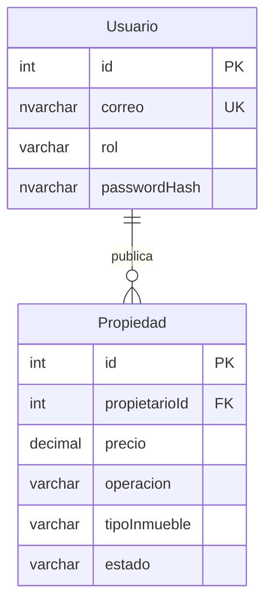

# Modelo inicial

El diccionario ejecutable completo está en database/01_schema.sql. Todos los campos son obligatorios excepto bloqueoHasta, latitud, longitud y motivoRechazo. Las coordenadas deben ser ambas nulas o ambas informadas; el motivo se exige al rechazar. Usuario usa nombre/apellido NVARCHAR(80), teléfono NVARCHAR(25), correo único NVARCHAR(254), passwordHash NVARCHAR(255), rol VARCHAR(10), intentosFallidos INT y bloqueoHasta DATETIME2. La sal y parámetros del hash deberán conservarse en la representación de la biblioteca elegida.

Propiedad usa título NVARCHAR(150), descripción NVARCHAR(2000), precio DECIMAL(18,2), operación VARCHAR(10), tipoInmueble VARCHAR(15), habitaciones/baños SMALLINT, dirección NVARCHAR(250), coordenadas DECIMAL(9,6), estado VARCHAR(10) y motivo NVARCHAR(500). Los IDs son INT IDENTITY. El estado predeterminado es PENDIENTE. Operación significa arriendo o venta; tipo significa casa, apartamento u otro.

La base permite ADMIN para cuentas administradas; el formulario público solo permite COMPRADOR o AGENTE. La API futura deberá verificar permisos y que propietarioId corresponde al agente autenticado. La FK por sí sola no valida roles. El modelo Java de esta entrega contiene los datos básicos sin credenciales ni coordenadas; esos campos se incorporarán al implementar autenticación y mapa.
